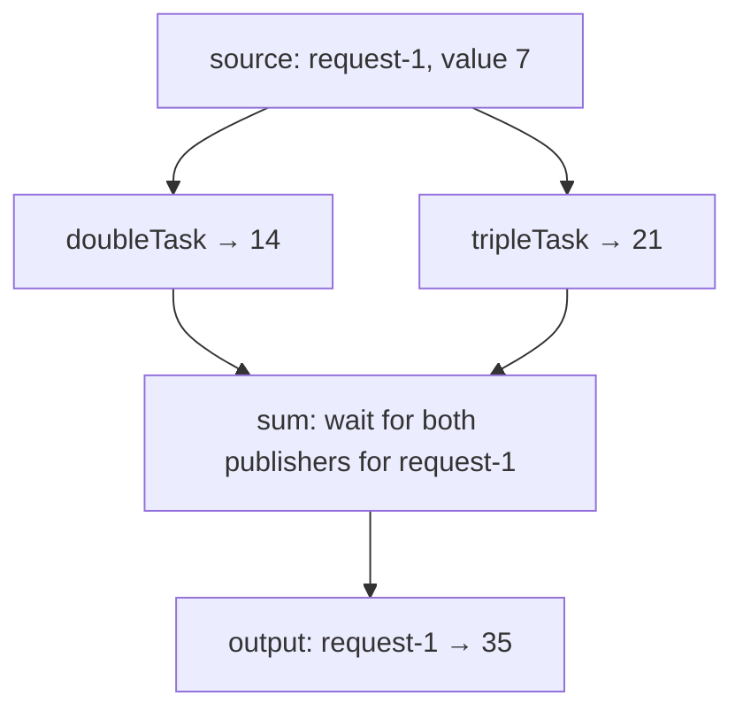

# AgentFlow

A small Java 17 framework for asynchronous, message-driven task graphs. Each task has a bounded FIFO mailbox. Arriving messages schedule processing on an executor; idle tasks do no work and occupy no worker threads.

## Execution model

- `Task<X>` receives messages through `accept(X)` and handles them in `process(X)`. Each task has an immutable `name()` and a unique instance `id()`; unnamed constructors generate a unique name.
- Each task processes one message at a time, in mailbox order. Different tasks can run concurrently.
- `RelayTask<X, Y>` transforms inputs and enqueues outputs in downstream tasks. Fan-out, fan-in, cycles, and self-relays are supported.
- `JoinTask<K, V, R>` collects values by request ID and publishing task name, and combines them only when every subscribed publisher has contributed. Publisher names and instance IDs are attached automatically during forwarding.
- `Agent` owns a shared executor for its tasks. By default, its worker count is the smaller of the task count and available processors, with a minimum of one. Set `parallelism(...)` to choose explicitly.
- A worker handles at most 64 messages per turn before yielding to other scheduled tasks. It leaves the executor when its mailbox is empty; the next arrival schedules it again.
- User processing and message forwarding run outside mailbox locks. `accept()` never invokes downstream processing inline.

There is no polling loop, adaptive sleep, or dedicated thread per task. Mailboxes and task state are in memory; they are not persisted across process restarts.

## Example

```java
import java.time.Duration;
import java.util.concurrent.CountDownLatch;
import java.util.concurrent.TimeUnit;

import com.cynthiasystems.agentflow.Agent;
import com.cynthiasystems.agentflow.tasks.RelayTask;
import com.cynthiasystems.agentflow.tasks.Task;

public class Example {
    public static void main(String[] args) throws InterruptedException {
        CountDownLatch delivered = new CountDownLatch(1);
        RelayTask<String, Integer> length = RelayTask.of(String::length);
        RelayTask<Integer, Integer> doubleLength = RelayTask.of(n -> n * 2);
        Task<Integer> print = new Task<>() {
            @Override
            protected void process(Integer message) {
                System.out.println(message);
                delivered.countDown();
            }
        };

        length.relay(doubleLength);
        doubleLength.relay(print);
        Agent agent = Agent.builder()
            .task(length)
            .task(doubleLength)
            .task(print)
            .parallelism(2)
            .build();

        // Messages can be queued before the agent starts.
        length.accept("hello");
        try {
            agent.start();
            if (!delivered.await(5, TimeUnit.SECONDS)) {
                throw new IllegalStateException("Message was not delivered");
            }
        } finally {
            agent.stop();
            if (!agent.awaitStopped(Duration.ofSeconds(5))) {
                throw new IllegalStateException("Agent is still stopping");
            }
        }
    }
}
```

This prints `10`. The same pipeline works with a single worker: each stage enqueues work for the next stage and returns.

## Custom tasks

Extend `Task<Input>` for stateful consumers or custom routing:

```java
public class TotalTask extends Task<Integer> {
    private int total;

    public TotalTask() {
        super(256); // Maximum number of waiting messages.
    }

    @Override
    protected void process(Integer amount) {
        total += amount;
    }
}
```

Only one processor enters a given task at a time. If other application threads read or change task-owned fields, provide synchronization for those accesses. Messages themselves should preferably be immutable.

Use `RelayTask.of("doubleTask", function)` to name a transformation, or `new RelayTask<>("doubleTask", function, capacity)` to choose mailbox capacity. The unnamed overloads remain available. Custom consumers can call `super("consumerName")` or `super("consumerName", capacity)`.

`relay(task)` forwards ordinary values to a compatible consumer. `relay(join, requestIdExtractor)` subscribes a join and automatically labels publications with the publishing task's name and unique instance ID. The extractor reads the request ID from the publisher's **original input**, so a transformation can return a plain value without manually building an envelope.

Names must be unique across an agent and its connected graph. Before any worker starts, the graph is validated and subscriptions are frozen across the entire connected component, including upstream publishers and downstream consumers. Duplicate subscriptions are rejected. Starting any node also freezes its connected graph. Connections cannot be added after startup or between restarts; create a new graph to change wiring.

## Diamond graphs and joins

Connecting two publishers to the same `RelayTask` gives **fan-in**: the receiver processes each value separately. A **join** combines matching publications into one output. The graph shape alone does not tell a node which behavior you want.



The join learns its required publishers from its subscriptions. You name the tasks and provide a correlation-ID extractor when wiring each publisher to the join:

```java
record Request(String id, int value) {}

RelayTask<Request, Integer> doubleTask =
    RelayTask.of("doubleTask", request -> request.value() * 2);
RelayTask<Request, Integer> tripleTask =
    RelayTask.of("tripleTask", request -> request.value() * 3);
JoinTask<String, Integer, Integer> sum = new JoinTask<>(
    "sum",
    new JoinPolicy(Duration.ofSeconds(10), 100, 1_000, 1_024),
    (requestId, inputs) -> inputs.get("doubleTask") + inputs.get("tripleTask"),
    failure -> System.err.println(failure));

doubleTask.relay(sum, Request::id);
tripleTask.relay(sum, Request::id);
// sum.publisherNames() is now {"doubleTask", "tripleTask"}.

Request request = new Request("request-1", 7);
doubleTask.accept(request);
tripleTask.accept(request);
```

The snippet configures the graph and queues work; include the nodes in an agent and start it to process the inputs, as in the complete demo below. To use a source node for fan-out, connect it with `source.relay(doubleTask)` and `source.relay(tripleTask)`.

A publication envelope contains three distinct identities/data fields:

| Field | Purpose |
| --- | --- |
| `requestId` | Correlates results for the same original operation; all publishers must preserve the same ID. |
| `publisherName` and `publisherId` | Identify which subscribed task supplied the value. The forwarding layer fills both automatically. |
| `value` | The result produced by that publisher's transformation. |

Internally the join stores `pending[requestId][publisherName] = value`. Readiness means that all subscribed publisher names are present for that **same request ID**. A second value from `doubleTask` cannot substitute for a missing value from `tripleTask`, and publications for different request IDs never share slots. The instance ID is checked against the registered publisher, so an envelope with a matching name but a different task ID is rejected.

Each arrival is handled when scheduled. If inputs are incomplete, the join stores them and releases the worker immediately. Once complete, it removes that request's pending slots, remembers the finished ID, and calls the combining function with the request ID and an immutable map keyed by publishing task name. No worker blocks waiting for another publisher.

Use `sum.relay(nextTask)` to forward the combined value. A join can itself publish into another join: `sum.relay(nextJoin, JoinInput::requestId)` preserves correlation using the incoming envelope. All publishers of one join share its generic value type `V`; heterogeneous payloads can use a common interface or tagged value type. Prefer immutable messages and IDs.

`JoinInput` is the envelope generated by the forwarding layer; normal graph code does not construct it. `publisherNames()` returns an immutable snapshot of the configured names. The required publisher set freezes when the graph starts, so a pending request's requirements cannot change mid-flight. A join with no publishers fails validation before execution starts.

### Join policies

| Situation | Behavior |
| --- | --- |
| Duplicate publication from the same task for an incomplete request | First value wins, including when a later value differs. It does not count twice or extend the deadline. |
| All subscribed publishers contribute | Remove the partial request, remember its ID, and invoke the combining function once. |
| A required publisher is missing at the deadline | Remove the partial request and call the failure handler with `TIMEOUT` and the missing publisher names. |
| Incomplete-request capacity is reached | Reject the new request through the failure handler with `CAPACITY`; preserve existing partial requests. Since no value is retained for the rejected request, all subscribed publishers are reported as missing. |
| Late input for a completed, expired, or rejected request | Ignore it while its ID remains in the bounded finished-request history. |
| Unknown publisher name or mismatched publisher instance ID | Fail the task with `IllegalArgumentException`; this is a graph/configuration error. |
| Stop and restart the same task instance | Keep partial inputs, queued messages, original deadlines, and finished-request history. Cancel the timer while stopped; expire overdue partial requests before processing queued inputs on restart. |

The deadline starts when the first input for a request is **processed**, using monotonic time. A final input processed at or after the deadline is too late, even if it was queued earlier. Duplicate inputs never reset the clock. This is a processing-time deadline, not a deadline measured from the original source event.

One shared daemon scheduler sends one-shot notifications for the next pending deadline. These notifications do not consume mailbox capacity and are coalesced; a full inbox cannot drop a timeout. Expiration and failure callbacks run serially on the join's worker. No periodic scan or polling loop is used. Busy or blocked user code can delay timeout notification delivery, but cannot make a late result pass the deadline check.

`JoinPolicy` requires positive values for all bounds. Defaults are a 30-second timeout, 1,024 incomplete requests, 4,096 remembered finished IDs, and 1,024 queued messages. These are separate limits: the mailbox bounds waiting messages, while the incomplete-request limit bounds accumulated partial results. Finished IDs are evicted oldest-first when history fills. **Duplicate suppression is bounded, not an exactly-once guarantee:** an evicted ID can be treated as a new request. Use unique request IDs and size history for your expected replay window; use durable storage if deduplication must survive process restarts.

Timeout and capacity outcomes do not stop the join. Its failure handler can log, record, or enqueue an error message. If the handler, combining function, or downstream delivery throws, the task fails through the normal `Task` lifecycle. The triggering request is already finalized and is not automatically replayed. Other incomplete requests survive restart with their original deadlines. Downstream fan-out remains nontransactional.

### Run the diamond demo

The complete [DiamondDemo](src/main/java/com/cynthiasystems/agentflow/examples/DiamondDemo.java) runs two overlapping requests through `doubleTask`, `tripleTask`, and `sum`. Its transformations return plain integers; the subscription wiring supplies publisher identity and correlation:

```sh
mvn -q compile
java -cp target/classes com.cynthiasystems.agentflow.examples.DiamondDemo
```

Expected output:

```text
request-1 -> 35
request-2 -> 55
```

The default is **one shared worker**, demonstrating that waiting for missing inputs never occupies that worker. To run with four workers:

```sh
java -cp target/classes com.cynthiasystems.agentflow.examples.DiamondDemo 4
```

## Lifecycle and shutdown

Tasks move through `CREATED`, `STARTED`, `STOPPING`, and `STOPPED`. An exception during processing or a lifecycle hook ends the run in `FAILED`; `failure()` exposes its cause.

- `start()` is idempotent while running. An agent starts all its tasks on its own pool. A standalone task's `start()` creates a single daemon worker executor; `start(executor)` uses an asynchronous executor owned by the caller.
- `beforeStart()` and `initialize()` run once per start, before message processing, even if stop was requested before the worker began.
- `stop()` requests shutdown and returns without waiting. A message already dequeued for processing is allowed to finish. Pending messages remain in the mailbox for a later restart; they are not drained automatically.
- `cleanup()` and `afterStop()` run once when a started run stops or fails. Cleanup is attempted even if initialization fails. Hooks normally run on the executor; if scheduling is rejected, cleanup runs on the submitting thread. Hook failures are recorded, with additional failures attached as suppressed exceptions.
- `awaitStopped(Duration)` waits for completion with a timeout and returns `false` if work is still running. It propagates interruption. Do not call it from a worker or hook belonging to the task or agent being awaited.
- Wait for shutdown to finish before restarting. Retained messages resume on restart, and the previous failure is cleared.

An agent requests all its tasks to stop before closing its executor. It does not interrupt processing or forcibly terminate user code. A blocked processing function can outlive a shutdown timeout. Keep I/O bounded with appropriate timeouts.

All internally created workers are daemon threads, so they do not keep the JVM alive. Applications should explicitly wait for results or coordinate their own application lifecycle, as in the example.

## Capacity and failure semantics

The default mailbox capacity is 1,024 waiting messages, excluding any message currently being processed. `accept()` accepts non-null messages before startup, while running, and after stop or failure. A full mailbox immediately throws `RejectedExecutionException`; enqueueing never waits for capacity.

Processing failures stop that task, while other tasks remain runnable. The failed message has already been removed and is **not automatically retried**. Later messages remain queued. This prevents accidental replay of side effects; applications can implement their own retry or error-message policy in `process()`.

Fan-out is sequential and not transactional. If one downstream mailbox rejects a result, earlier subscribers may already have received it and later subscribers will not. The publisher fails visibly, with no automatic replay. A null transformation result also fails if it is forwarded to a subscriber. Choose capacities and handle failures according to the application's delivery requirements.

## Periodic work

For timers, use a `ScheduledExecutorService` to enqueue a tick message through `accept()`. The task itself remains event-driven. Stop the external scheduler as part of your application's shutdown, and handle mailbox overflow in the producer.

## Migration from the polling API

This is a breaking API change:

- Replace `AdaptiveRelayTask<X, Y>` with `RelayTask<X, Y>`; `of(...)`, `accept(...)`, and `relay(...)` remain available.
- Replace custom `Task` subclasses with `Task<Input>` and implement `process(Input)` instead of `process()`, `shouldProcess()`, and `calculateSleepTime()`.
- `AdaptiveTimingTask` and its timing fields are removed. Use messages or scheduled ticks to trigger work.
- `Task` no longer implements `Runnable`. Per-task thread inspection (`isThreadAlive()` and `getThreadName()`) is replaced by lifecycle state and `awaitStopped(...)`.
- `stop()` is now nonblocking. Follow it with `awaitStopped(...)` when completion matters.
- `beforeStart()` now runs on the worker alongside initialization. The public inbox inspection API is `inboxSize()`; indexed inbox access is removed.

### Migration from explicit join branch labels

- Give each publisher a unique task name.
- Replace the join constructor's required-branch set with the join's own name, for example `new JoinTask<>("sum", policy, combine, onFailure)`.
- Return plain values from publishers, then connect with `publisher.relay(join, Input::requestId)`.
- Access the combining function's map by publisher task name instead of manually assigned labels.
- Use `JoinFailure.missingPublishers()` for timeout/capacity diagnostics.
- Complete all wiring before startup; subscriptions stay frozen across restart.

## Build and test

Requires JDK 17 and Maven:

```sh
mvn clean verify
```

Verification runs the unit tests, Checkstyle, PMD, duplicate-code detection, Spotless, SpotBugs, and JaCoCo gates requiring **100% line coverage and 100% branch coverage** across production code, including the demo, with no configured coverage exclusions. Tests use controlled executors, clocks, barriers, and latches to exercise idle wake-ups, FIFO ordering, concurrent producers, cyclic graphs, failures, and shutdown without fixed sleeps. Join tests cover out-of-order and overlapping requests, duplicates, exact timeout boundaries, a full mailbox at expiration, incomplete-request limits, bounded duplicate history, restart, and callback failures. Named-publisher tests also cover automatic identity, correlation, duplicate names/subscriptions, invalid publisher IDs, graph freezing, and chained joins. The diamond demo is tested with one and four shared workers; a separate integration test verifies that a real timer wakes an idle join.

## License

[MIT License](LICENSE)
